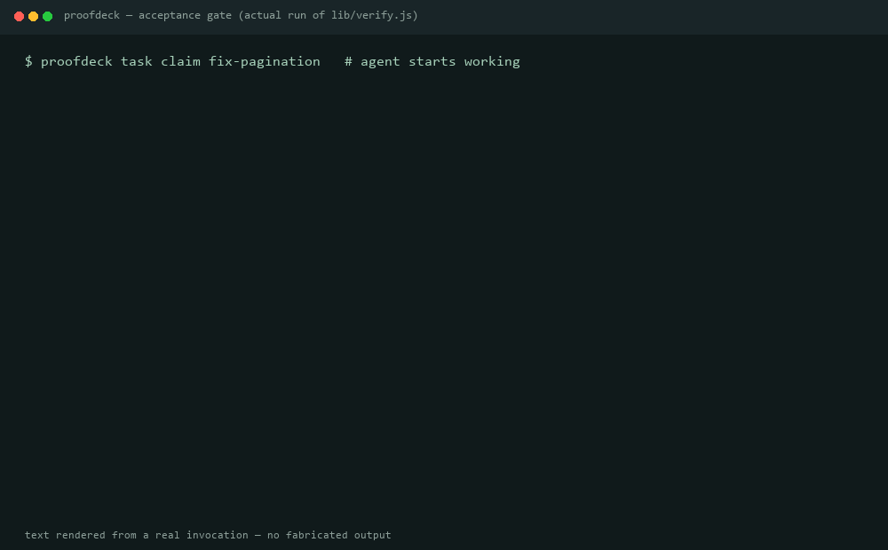

<div align="center">
  

  <h1>ProofDeck</h1>

  <p><strong>Verification-first task board &amp; orchestrator for coding-agent fleets.</strong><br>
  <em>Agents claim done. ProofDeck demands proof.</em></p>

  <p>
    <a href="https://github.com/kumu314/proofdeck/actions/workflows/ci.yml"></a>
    <a href="https://www.npmjs.com/package/proofdeck"></a>
    <a href="./LICENSE"></a>
    
    
  </p>

  <p>
    <a href="#quick-start">Quick start</a> ·
    <a href="#why">Why</a> ·
    <a href="#architecture">Architecture</a> ·
    <a href="#the-five-check-families">Checks</a> ·
    <a href="./README.zh-CN.md">中文文档</a>
  </p>
</div>

<div align="center">
  
  <p><sub><b>The gate in 7 seconds:</b> an agent claims <i>done</i> on 1 item where acceptance said ≥3 — the real verify engine rejects it, the task returns to open, a verify event lands in the hash chain. Rendered from an actual run; nothing fabricated.</sub></p>
</div>

## Why

One coding agent (Claude Code, Codex CLI, Gemini CLI, …) → you review everything it does, and review works. **Several agents in parallel → review becomes the bottleneck**, and two failure modes compound:

| Failure mode | What it looks like | Industry context |
|---|---|---|
| **False affirmatives** | A fallback makes it "work"; tests pass; the flaw ships | *Reward hacking* — active research area (ImpossibleBench 2025, Anthropic 2026) |
| **Silent death** | Stalls, exits 0 with nothing done, burns budget in a loop | Nobody notices until the deadline |

ProofDeck's answer is to make **acceptance criteria a first-class column on every task** and refuse "done" that lacks evidence — then wrap that gate in everything a fleet needs.

## The gate — how `done` gets proven

1. **Declare.** Every task carries machine-checkable acceptance criteria.
2. **Verify.** On completion a fail-closed engine runs them — five check families, unknown check types are FAIL, never skip.
3. **Judge.** When machine checks aren't enough, an LLM judge reviews the trajectory against the criteria.
4. **Record.** The verdict lands in an **append-only sha256 hash chain** — who claimed, who verified, when, with evidence.
5. **React.** Failed tasks retry with backoff, park for human review, or route to another agent by capability. Never silently done.

## Features

| Area | What you get |
|---|---|
| **Board** | Shared SQLite-backed task board with an MCP surface — any MCP-speaking agent reads/writes it |
| **Evidence** | Append-only sha256 chain over tasks/notes/messages/verify events; `verifyChain()` head anchoring |
| **Orchestration** | Priority lanes with aging · automatic retry with backoff · supply breaker · capability routing (`needs` × face capabilities) |
| **Judgment** | LLM judge (V1.5) with acceptance-only mode; human (V3) and cross-review (V2) escalation |
| **Observability** | Full event replay (time travel to any seq) · OpenTelemetry-style spans · per-run usage ledger |
| **Ops** | SLA due-dates · owner digest · leases · watchdog · offline-first (one SQLite file, no cloud) |

## Quick start

Requirements: **Node ≥ 22.5** (native `node:sqlite`; `better-sqlite3` fallback for older runtimes), Windows or Linux.

```bash
npx proofdeck init        # scaffold: daemon.config.json + .proofdeck/ + control.token
# edit daemon.config.json — point agents.codex.script at a CLI you have
npx proofdeck daemon      # start the daemon (board + control plane + scheduler)
npx proofdeck status      # board head, task counts, acceptance coverage
```

From a git checkout:

```bash
git clone https://github.com/kumu314/proofdeck && cd proofdeck
npm install                              # zero native module deps
node bin/proofdeck.js init && node bin/proofdeck.js daemon
```

Define a task with acceptance criteria, dispatch your agent, and watch the gate. Any agent that speaks MCP can read/write the board.

**Task books.** A task's instruction text lives in a file under `briefs/` with a small ```bridge fence carrying dispatch metadata (`auto`, `risk`, …); the card references it by path. The gate reads the book before dispatch — full format and gotchas in [docs/task-book.md](./docs/task-book.md).

## Architecture

```
                       ┌───────────────────────────────────────────┐
                       │                ProofDeck                  │
  human ──define──────▶│  daemon: claim → run face → verify gate   │
  agents ◀──MCP────────│          │                                │
  (CLI faces)  ──run──▶│          ├─ V1 checks (fail-closed)       │
                       │          ├─ V1.5 LLM judge               │
                       │          ├─ retry / breaker / routing    │
                       │          ▼                                │
                       │  blackboard: SQLite WAL + append-only     │
                       │  sha256 hash chain (tasks, notes, verify  │
                       │  events, messages — tamper-evident)       │
                       └───────────────────────────────────────────┘
```

| Component | File | Role |
|---|---|---|
| Board | `board/` | Vendored, modified [octopus-blackboard](https://github.com/octoryn/octopus-blackboard) fork — hash chain, MCP, acceptance/verification schema (see [NOTICE](./NOTICE)) |
| Verify engine | `lib/verify.js` | Fail-closed check runner, task-column-first acceptance |
| LLM judge | `lib/judge.js` | V1.5 trajectory review; unavailable judge fails open |
| Scheduler | `lib/schedule.js` | P0–P3 lanes, aging, retry policy (pure, unit-tested) |
| Routing | `lib/caps.js` | `needs` × face-capability matching |
| Replay | `lib/replay.js` | Fold timeline to any seq, diff against now |
| Platform | `lib/platform.js` | Dual-OS process primitives (killTree / getProcessInfo) |
| Adapters | `lib/adapters/` | One small module per agent face; `codex.js` is the reference implementation |

## The five check families

| Check | Asserts | Example |
|---|---|---|
| `fileExists` | File exists, ≥ `minBytes` | a rendered artifact actually shipped |
| `countAtLeast` | JSON value (number/array length) ≥ `min` | `report.count ≥ 3` |
| `countOccurrences` | Literal substring count ≥ `minCount` | changelog mentions the fix |
| `countMatches` | JSON-path match count ≥ `min` | every item has a status field |
| `referencesExist` | Files referenced in JSON exist | every asset in the manifest is on disk |

Unknown check types are **FAIL** — a typo in acceptance criteria never silently passes.

## Design principles

- **Fail closed.** Missing acceptance is flagged on every dispatch, never skipped.
- **Evidence over vibes.** Verification results are hash-chain events, not chat messages.
- **The board is the truth.** Agents come and go; the append-only timeline remembers.
- **Boring storage.** One SQLite file per deployment — no cloud, no telemetry.
- **Prompts via stdin, never argv.** Long CJK text corrupts through some shells (a production lesson).

## Testing

13 e2e suites run against real boards — verification, anti-fraud, judge, scheduling, resilience (watchdog/guard), replay, SLA/digest, lease, schema evolution:

```bash
npm test                                                 # native backend
OCTOBOARD_BACKEND=better-sqlite3 npm test                # fallback backend
```

CI runs the full matrix on Windows + ubuntu, both backends — the native cell installs with `--omit=optional`, proving zero-native-dependency installs.

## Status

`v0.1.0`. Daily-production-proven on Windows (a personal multi-agent fleet, hundreds of tasks). Linux is CI-validated (13/13) with thinner real-world mileage — rough edges expected, reports welcome.

## Related projects

- **[Agent-Evals](https://github.com/kumu314/agent-evals)** — deterministic, no-LLM-judge evals for AI agents: skill-lift A/B across 11 models plus zero-API regression suites for skill libraries and content merges. Where ProofDeck gates **each task at runtime**, Agent-Evals scores **capabilities offline** — together they cover the full verification story: runtime acceptance gates + offline regression evidence, from the same fleet.

## Contributing & security

[CONTRIBUTING.md](./CONTRIBUTING.md) — PRs need CI green and pasted evidence, same standard as our agents. Security disclosures via [SECURITY.md](./SECURITY.md) (private reporting, 7-day response). Releases tagged — see [CHANGELOG.md](./CHANGELOG.md).

## License

[Apache-2.0](./LICENSE). Includes a modified distribution of [octopus-blackboard](https://github.com/octoryn/octopus-blackboard) by Ran Tao / octoryn — see [NOTICE](./NOTICE).
