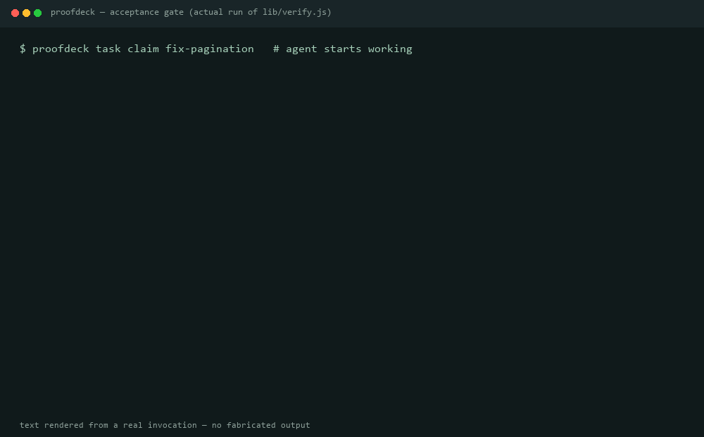

<div align="center">
  

  <h1>ProofDeck</h1>

  <p><strong>验证优先的编码 agent 舰队任务板与编排器。</strong><br>
  <em>Agent 说 done，ProofDeck 要证据。</em></p>

  <p>
    <a href="https://github.com/kumu314/proofdeck/actions/workflows/ci.yml"></a>
    <a href="https://www.npmjs.com/package/proofdeck"></a>
    <a href="./LICENSE"></a>
    
    
  </p>

  <p>
    <a href="#快速开始">快速开始</a> ·
    <a href="#为什么">为什么</a> ·
    <a href="#架构">架构</a> ·
    <a href="#五类检查族">检查族</a> ·
    <a href="./README.md">English</a>
  </p>
</div>

<div align="center">
  
  <p><sub><b>7 秒看懂门禁：</b>agent 在验收要求 count≥3 的任务上只交付了 1 项就声称 <i>done</i>——真实验证引擎当场拒绝，任务退回 open 重新派发，验证事件落进哈希链。内容来自真实运行渲染，无任何虚构。</sub></p>
</div>

## 为什么

只跑一个编码 agent（Claude Code、Codex CLI、Gemini CLI……）时，你会 review 它的每一步，review 是有效的。但你一旦**并行跑好几个**，review 就成了瓶颈，两种失败模式叠加：

| 失败模式 | 典型表现 | 业界语境 |
|---|---|---|
| **虚假确认** | 加个 fallback 让代码"能跑"，测试也过了，缺陷照样上线 | *reward hacking*——活跃研究课题（ImpossibleBench 2025、Anthropic 2026） |
| **静默死亡** | 卡住、rc=0 但什么都没干、预算烧进死循环 | 截止日期前没人发现 |

ProofDeck 的答案是：**把验收标准做成每张任务的一等公民**，拒绝没有证据的"done"——再在这道门禁外面套上整支舰队需要的一切。

## 门禁——"done" 如何被证明

1. **声明。** 每张任务携带机器可校验的验收标准。
2. **验证。** 完成时 fail-closed 引擎执行验收——五类检查，未知类型一律 FAIL，绝不跳过。
3. **复核。** 机器检查不够时，LLM judge 依据验收标准复核轨迹。
4. **记账。** 判定连同"谁认领、谁验证、何时"写进**追加式 sha256 哈希链**。
5. **响应。** 失败任务按退避重试、转人工复核、或按能力路由给其他 agent——绝不静默标记完成。

## 特性总览

| 领域 | 能力 |
|---|---|
| **黑板** | SQLite 共享任务板 + MCP 面——任何说 MCP 的 agent 可读写 |
| **证据** | 任务/注记/消息/验证事件的追加式 sha256 链；`verifyChain()` 锚定校验 |
| **编排** | 带 aging 的优先级车道 · 指数退避自动重试 · 供应熔断 · 能力路由（`needs` × 面能力） |
| **判定** | LLM judge（V1.5，acceptance-only 模式）；人工（V3）与交叉评审（V2）升级 |
| **观测** | 全量事件回放（时间旅行到任意 seq）· OpenTelemetry 风格 span · 单轮用量台账 |
| **运维** | SLA 到期 · owner 摘要 · 租约 · 看门狗 · 离线优先（一个 SQLite 文件，无云依赖） |

## 快速开始

环境要求：**Node ≥ 22.5**（原生 `node:sqlite`；旧运行时用 `better-sqlite3` 回退），Windows 或 Linux。

```bash
npx proofdeck init        # 脚手架：daemon.config.json + .proofdeck/ + control.token
# 编辑 daemon.config.json —— 把 agents.codex.script 指向你有的 CLI
npx proofdeck daemon      # 起守护（黑板 + 控制面 + 调度器）
npx proofdeck status      # 看板块 head、任务统计、验收覆盖
```

从 git 检出运行：

```bash
git clone https://github.com/kumu314/proofdeck && cd proofdeck
npm install                              # 零原生模块依赖
node bin/proofdeck.js init && node bin/proofdeck.js daemon
```

给任务写上验收标准、派出你的 agent，然后看门禁工作。任何说 MCP 的 agent 都能读写黑板。

**任务书。** 任务的题面放在 `briefs/` 下的文件里，带一小段 ```bridge 围栏块承载派发元数据（`auto`、`risk`……），卡面只放文件指针。门禁在派发前会读任务书做风险评估——完整格式与坑位见 [docs/task-book.md](./docs/task-book.md)。

## 架构

```
                       ┌───────────────────────────────────────────┐
                       │                ProofDeck                  │
  人 ──定义任务────────▶│  守护：认领 → 跑面 → 验证门禁             │
  agents ◀──MCP────────│          │                                │
  (CLI 面)  ──运行─────▶│          ├─ V1 检查（fail-closed）        │
                       │          ├─ V1.5 LLM judge               │
                       │          ├─ 重试 / 熔断 / 能力路由       │
                       │          ▼                                │
                       │  黑板：SQLite WAL + 追加式 sha256 哈希链  │
                       │  （任务/注记/验证事件/消息——防篡改可取证）│
                       └───────────────────────────────────────────┘
```

| 组件 | 文件 | 职责 |
|---|---|---|
| 黑板 | `board/` | [octopus-blackboard](https://github.com/octoryn/octopus-blackboard) 修改版发行——哈希链、MCP 面、验收/验证 schema（见 [NOTICE](./NOTICE)） |
| 验证引擎 | `lib/verify.js` | fail-closed 检查执行器，任务列优先的验收读取 |
| LLM judge | `lib/judge.js` | V1.5 轨迹复核；judge 不可用时优雅跳过 |
| 调度核 | `lib/schedule.js` | P0–P3 车道、aging、重试策略（纯函数、单测覆盖） |
| 路由 | `lib/caps.js` | `needs` × 面能力匹配 |
| 回放 | `lib/replay.js` | 折叠时间线到任意 seq，与当前态 diff |
| 平台 | `lib/platform.js` | 双 OS 进程原语（killTree / getProcessInfo） |
| 适配器 | `lib/adapters/` | 每个 agent 面一个小模块；`codex.js` 是参考实现 |

## 五类检查族

| 检查 | 断言 | 示例 |
|---|---|---|
| `fileExists` | 文件存在且 ≥ `minBytes` | 渲染产物真的出货了 |
| `countAtLeast` | JSON 值（数字/数组长度）≥ `min` | `report.count ≥ 3` |
| `countOccurrences` | 字面量子串出现次数 ≥ `minCount` | changelog 里提到了本次修复 |
| `countMatches` | JSON 路径匹配数 ≥ `min` | 每个条目都有 status 字段 |
| `referencesExist` | JSON 里引用的文件都存在 | manifest 里每个资产都在盘上 |

未知检查类型一律 **FAIL**——验收标准里的拼写错误永远不会静默放行。

## 设计原则

- **Fail closed。** 缺验收标准的任务每次派发都被标注提示，绝不静默跳过。
- **证据而非感觉。** 验证结果是哈希链事件，不是聊天记录。
- **黑板即真相。** Agent 来来去去；追加式时间线记得一切。
- **无聊的存储。** 每次部署一个 SQLite 文件——无云、无遥测。
- **题面走 stdin，绝不走 argv。** 长中文文本过某些 shell 会被搅坏（生产线换来的教训）。

## 测试

13 套端到端套件打在真实黑板上——验证、防刷分、judge、调度、韧性（看门狗/guard）、回放、SLA/摘要、租约、schema 演进：

```bash
npm test                                                 # 原生后端
OCTOBOARD_BACKEND=better-sqlite3 npm test                # 回退后端
```

CI 在 Windows + ubuntu × 双后端四格矩阵上跑全套；native 格用 `--omit=optional` 安装——在干净机器上实证"零原生依赖"。

## 状态

`v0.1.0`。Windows 上日常生产淬炼（个人多 agent 舰队，数百张任务）。Linux 已 CI 验证（13/13）但真实里程较薄——遇到坑请报 issue。

## 相关项目

- **[Agent-Evals](https://github.com/kumu314/agent-evals)** —— 面向 AI agent 的确定性评测（刻意不用 LLM judge）：技能增益 A/B 跨 11 模型 + 技能库与内容合并的零 API 回归套件。ProofDeck 在**运行时**给每张任务把门，Agent-Evals 在**离线**给能力做回归——两层合起来才是完整的验证故事：运行时验收门禁 + 离线回归证据，出自同一支舰队。

## 参与贡献与安全

[CONTRIBUTING.md](./CONTRIBUTING.md)——PR 需要 CI 绿 + 贴出证据，和我们的 agent 一个标准。安全披露走 [SECURITY.md](./SECURITY.md)（私有报告，7 天响应）。发版打 tag——见 [CHANGELOG.md](./CHANGELOG.md)。

## 许可

[Apache-2.0](./LICENSE)。含 [octopus-blackboard](https://github.com/octoryn/octopus-blackboard)（Ran Tao / octoryn）修改版发行——见 [NOTICE](./NOTICE)。
